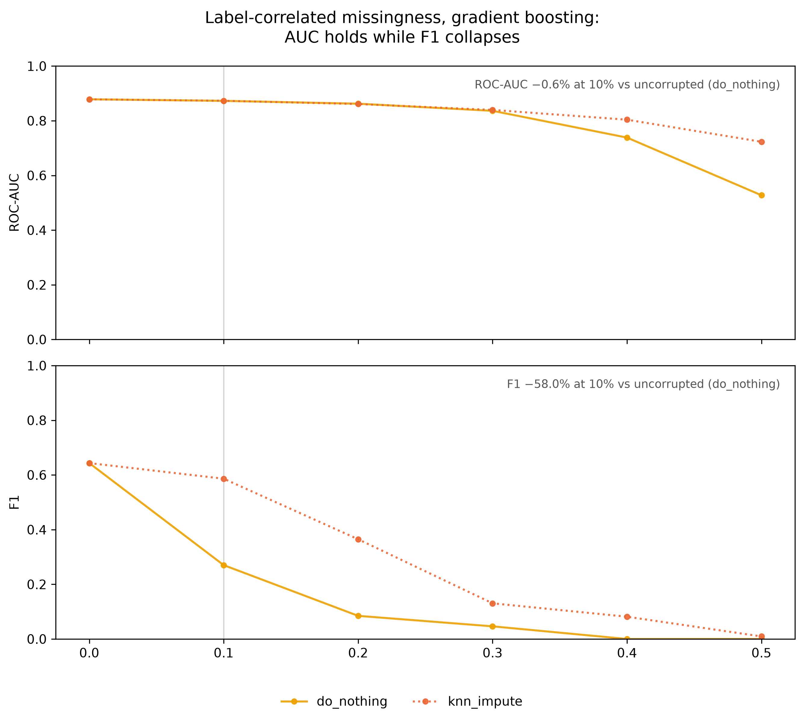
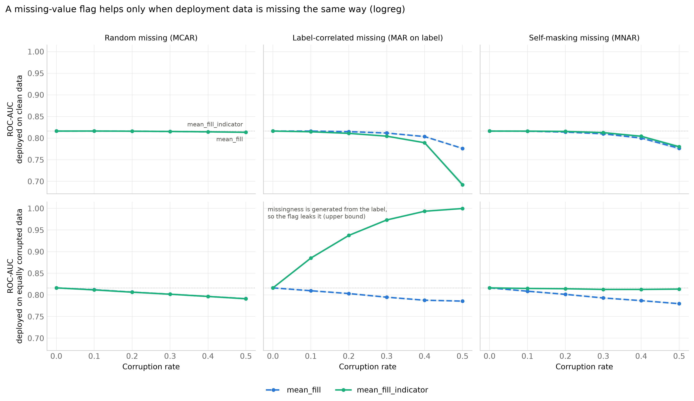
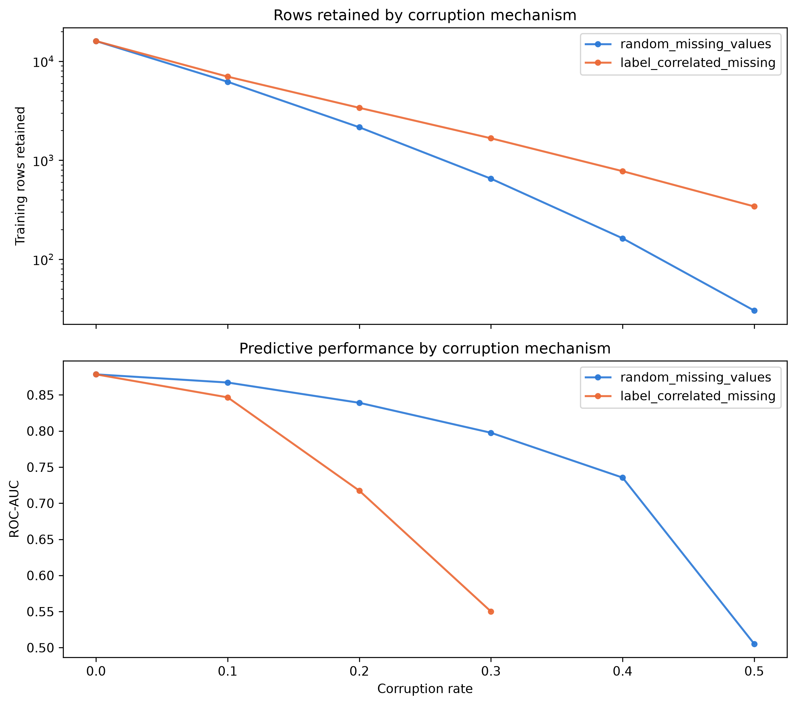
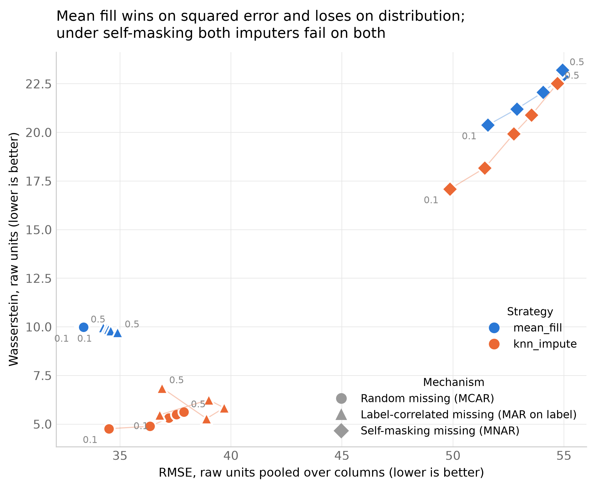
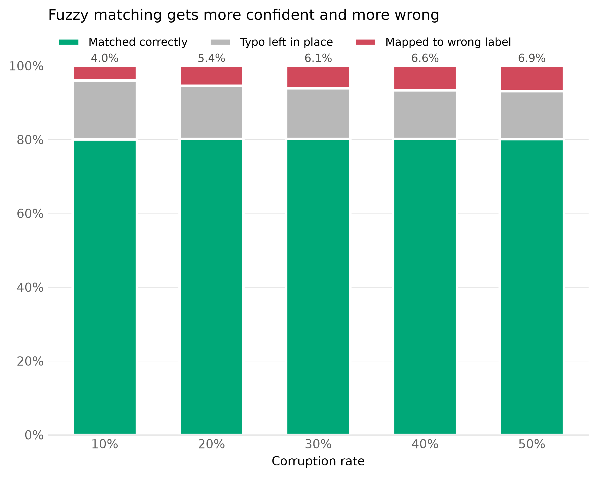

# Data Corruption & Cleaning Simulator

[](https://github.com/Northernstud/data-corruption-cleaning-simulator/actions/workflows/ci.yml)
[](https://www.python.org/downloads/)
[](LICENSE)
[](https://github.com/astral-sh/ruff)
[](https://scikit-learn.org/)
[](#scale)

**When does data cleaning actually help a model, and when does it make things worse?**

Cleaning methods are usually judged by how close the repaired values are to the truth. This project judges them by what happens to the downstream model. It deliberately corrupts a real dataset in controlled ways, repairs it with standard cleaning methods, and measures both how well each method recovered the true values and how well the trained model predicts. It runs 11,520 trained models across 20 random seeds.

The main finding is that **the same cleaning method can help or hurt depending on two things practitioners rarely check: *why* the data is missing, and whether the data the model will see in production is as messy as the data it was trained on.**

---

## Key findings

All numbers are means over 20 seeds. "Wins" counts how many of the 20 seeds a paired comparison went the same way. Every number below is recomputed from the saved results in [`notebook/findings.ipynb`](notebook/findings.ipynb).

### 1. Why data is missing matters more than how much is missing

With the same number of cells removed from the same 9 numeric columns (50% corruption), gradient boosting with no cleaning gives:

| Missingness mechanism | ROC-AUC | F1 |
|---|---|---|
| Uncorrupted baseline | 0.878 | 0.643 |
| Random (MCAR) | 0.868 | 0.619 |
| Self-masking (MNAR: high values go missing) | 0.862 | 0.615 |
| **Label-correlated** (cancelled bookings 3× more likely to have gaps) | **0.527** | **0.000** |

When missingness depends on the outcome, the model learns that a missing value means "cancelled". On complete production data that signal never appears, and the model predicts "not cancelled" for everyone. AUC barely moves at low corruption (−0.6% at 10%), while F1 falls by 58%. **Monitoring AUC alone would miss this failure entirely.**



### 2. A missing-value flag helps or hurts depending on the deployment data

A common recommendation is to add a binary "this value was missing" column next to the imputed value. For logistic regression under label-correlated missingness at 10% corruption:

| Deployed on… | Mean fill F1 | Mean fill + flag F1 | Wins |
|---|---|---|---|
| clean data | 0.528 | **0.190** | flag worse in 20/20 seeds |
| equally corrupted data | 0.496 | **0.679** | flag better in 20/20 seeds |

Under true MNAR (self-masking), the flag holds AUC at 0.813 when production data has the same missingness, versus 0.780 for mean fill alone (20/20 seeds), and does no harm on clean data. **Whether to add a flag is a question about deployment, not about the training data.**



### 3. Tree models build that flag on their own; linear models can't

Mean fill writes the exact same number into every gap. A gradient-boosted tree can split on "value equals the column mean", which works like a hidden missing-value flag. So under the same corrupted-deployment condition, gradient boosting with plain mean fill reaches the same AUC as with an explicit flag, while logistic regression needs the flag (0.786 without it vs 1.000 with it). The same mechanism explains why **KNN imputation is the most robust choice for trees when deployment data is clean**. KNN fills each gap with a different value, so there's no single number to latch onto: AUC 0.723 vs 0.527 for no cleaning at 50% label-correlated missingness (20/20 seeds).

### 4. Dropping incomplete rows is the most damaging strategy

With 9 numeric columns, a row survives only if all 9 values are present. At 30% random missingness that's 0.7⁹ ≈ 4% of rows. Of 16,000 training rows, drop-rows keeps **6,204 at 10%, 652 at 30%, and 30 at 50%** corruption, and AUC falls to 0.505 (no better than chance). Under label-correlated missingness it also removes cancelled bookings selectively. From 40% corruption onward, and in some seeds already at 30%, every cancelled booking is gone and the model cannot be trained at all.



### 5. Recovering the true values is not the same as making the model better

| Mechanism | Strategy | RMSE | Wasserstein | Bias (true − imputed) |
|---|---|---|---|---|
| Random (MCAR) | mean fill | **33.3** | 10.0 | −0.01 |
| Random (MCAR) | KNN | 36.7 | **5.2** | 0.35 |
| Self-masking (MNAR) | mean fill | 53.7 | 22.0 | **+21.8** |
| Self-masking (MNAR) | KNN | 52.5 | 19.7 | **+19.7** |

Mean fill has the lowest squared error but distorts the shape of the distribution. KNN keeps the distribution closer to the original but has higher error. Under self-masking, *both* methods systematically underestimate, because the values that went missing are exactly the high ones that the observed data under-represents. That's the classic reason no imputation method can recover MNAR data without modelling the missingness process itself.



### 6. Fuzzy matching has a built-in limit on word length

Fuzzy matching (RapidFuzz `ratio`, threshold 85) correctly restores about 80% of typos at every corruption rate. The share mapped to the *wrong* category rises from 4.0% to 6.9% as typos become more common. About 13–16% stay uncorrected, for a structural reason: one wrong character in an *n*-character word scores (n−1)/n, which only clears 0.85 for words of 7 or more characters, so words like `July`, `May`, `Direct` and `Groups` can never be fixed. Fuzzy matching matters most when production data also has typos and the model is linear: logistic regression's AUC drops from 0.816 to 0.662 with no cleaning, but holds at 0.772 with fuzzy matching (20/20 seeds). Gradient boosting barely notices typos either way.



---

## Experimental design

### Data

[Hotel Booking Demand](https://doi.org/10.1016/j.dib.2018.11.126) (Antonio, Almeida & Nunes, *Data in Brief*, 2019). The task is binary classification of `is_canceled`. After light cleaning and deduplication there are 86,426 bookings, of which 27.4% are cancelled. The experiment uses a fixed random sample of 20,000 rows, with 20 features: 9 numeric and 11 categorical.

### The pipeline

```
 20,000 rows ──split 80/20 (stratified, per seed)──┬── train (16,000) ──corrupt──clean──► fit model
                                                    │                                      │
                                                    └── holdout (4,000) ──► [clean]  ──────┤
                                                                        └─► [corrupted] ───┴─► score
```

For each seed, corruption rate, corruption type and cleaning strategy:

1. **Corrupt** the training set at a controlled rate, recording a mask of exactly which cells were changed.
2. **Clean** it with one strategy. Every cleaner learns only from the training set (means, fitted imputers, category vocabulary) and applies that same learned state to the holdout, so nothing leaks from test to train.
3. **Measure recovery:** compare the cleaned cells against the true values using the corruption mask.
4. **Train a model** and score it on the holdout under two deployment conditions:
   - **Clean holdout:** the model is used on complete, clean data.
   - **Corrupted holdout:** production data has the same corruption as the training data.

### Corruption mechanisms

| Mechanism | Columns | How it works |
|---|---|---|
| Random missing (MCAR) | 9 numeric | Uniform random sample of cells |
| Label-correlated missing (MAR given the label) | 9 numeric | Per-cell missing rate for cancelled bookings is 3× that of others, solved exactly so the overall rate matches the target |
| Self-masking missing (MNAR) | 9 numeric | Chance of going missing ∝ (percentile rank)³, so high values disappear first |
| Typos | 4 categorical | One random character substituted per selected cell |

### Cleaning strategies

| Strategy | Applies to | What it does |
|---|---|---|
| Do nothing | all | Baseline. Gradient boosting handles missing values natively, logistic regression cannot. |
| Drop rows | missing values | Remove every training row with any missing value (holdout rows can't be dropped, since a deployed model still has to predict them) |
| Mean fill | missing values | Fill each column with its training-set mean |
| Mean fill + missing flags | missing values | Mean fill plus one 0/1 "was missing" column per numeric feature |
| KNN imputation | missing values | `KNNImputer`, k = 3 |
| Fuzzy matching | typos | Map rare spellings onto frequent categories (RapidFuzz, threshold 85) |

### Models and metrics

- **Models:** `HistGradientBoostingClassifier` and `LogisticRegression` (standardized), each with one-hot encoding of categorical features.
- **Downstream metrics:** ROC-AUC (primary), F1, accuracy, number of rows trained on.
- **Numeric recovery metrics:** RMSE, MAE, bias, variance ratio, Wasserstein distance, computed only on corrupted cells.
- **Categorical recovery metrics:** share of typos matched correctly, left unchanged, or mapped to the wrong category.

### Scale

20 seeds × 6 corruption rates (0–50%) × 4 mechanisms × 6 strategies × 2 deployment conditions × 2 models = **11,520 trained and evaluated models**, about 5.5 hours on a 12-core laptop. Results are saved after each seed, so a crash doesn't lose finished seeds.

---

## Limitations

- **Single dataset.** The direction of the effects follows from how each mechanism works, but the exact sizes are specific to this data.
- **Label leakage in one condition.** In the corrupted holdout under label-correlated missingness, missingness is generated from the true labels, so models that can see missingness reach an AUC near 1.0. Treat that condition as an upper bound on how much missingness can give away about the label, not as a realistic score.
- **F1 uses a fixed 0.5 threshold,** so it reflects calibration shifts as well as ranking quality. ROC-AUC is the primary metric for that reason.
- **Recovery metrics are pooled across columns in raw units,** so `lead_time` and `adr` dominate. Normalizing each column first would make columns comparable.
- **Synthetic corruption.** These mechanisms are idealized versions of real data-quality problems, and the cleaner settings (k, threshold) were not tuned.

---

## Reproducing the results

```bash
python -m venv .venv && source .venv/bin/activate
pip install -r requirement.txt

# 1. download hotel_bookings.csv to data/raw/  (Kaggle: "Hotel booking demand")
python -m src.load              # writes data/processed/

# 2. run the full experiment grid (~5.5 h; results/experiments.parquet)
python -m src.run_experiment

# 3. regenerate every figure into figures/
python -m src.plots
```

`results/experiments.parquet` is committed, so step 3 and the [findings notebook](notebook/findings.ipynb) work without running step 2:

```bash
pip install jupyter
jupyter notebook notebook/findings.ipynb
```

Every setting (columns, rates, seeds, strategies, mechanisms, deployment conditions) lives in `config.yaml`.

## Development

```bash
pip install ruff
ruff check src tests      # lint (pyflakes, pycodestyle, isort, bugbear)
python -m pytest          # 27 unit tests, run on a committed 2,000-row sample
```

Every push and pull request runs both through [GitHub Actions](.github/workflows/ci.yml) on Python 3.12, 3.13 and 3.14. The tests use `tests/data/hotel_bookings_sample.csv`, so they don't need the full dataset.

## Project structure

```
config.yaml            experiment grid and column roles
src/load.py            dataset preparation
src/corrupt.py         corruption mechanisms, each returns (corrupted_df, mask)
src/clean.py           cleaning strategies, fit on train, applied to holdout
src/evaluate.py        recovery and downstream metrics
src/run_experiment.py  full factorial experiment with per-seed checkpointing
src/plots.py           all figures
notebook/findings.ipynb  recomputes every finding, with paired seed-level evidence
results/experiments.parquet  saved results of the full run (11,520 rows)
tests/                 unit tests: corruption rates, masks, no input mutation, cleaner behaviour
tests/data/            2,000-row sample of the processed data used by the tests
figures/               fig1–fig7 (clean-deployment versions; *_corrupted_holdout for the other condition)
.github/workflows/     CI: ruff + pytest on Python 3.12–3.14
```

## Skills demonstrated

- **Experimental design:** full factorial simulation with controlled corruption, ground-truth masks, 20-seed replication, paired comparisons across seeds, and a separate train/deploy condition to isolate train/deploy mismatch.
- **Statistics and missing-data theory:** MCAR / MAR / MNAR mechanisms, the bias of imputation under MNAR, selection bias from dropping incomplete rows, distribution-level metrics (Wasserstein distance) alongside point-error metrics.
- **Machine learning:** scikit-learn pipelines, `ColumnTransformer`, gradient boosting vs linear models, leakage-safe preprocessing (fit on train, transform on test), analysis of how metrics behave (AUC vs threshold-dependent F1).
- **Data cleaning and engineering:** KNN imputation, missing-value flags, fuzzy string matching with RapidFuzz, pandas data handling at the level of individual cells.
- **Software engineering:** modular pipeline driven by a config file, 27 pytest unit tests (including tests written to reproduce bugs found during analysis), GitHub Actions CI testing 3 Python versions, ruff linting, checkpointed long-running jobs, reproducible seeding.
- **Data visualization:** small-multiple figures in matplotlib with a colour palette validated for colour-blind readers.
- **Scientific debugging:** found and fixed confounds that would have invalidated the comparisons. For example, an early corruptor spread "missing" cells across categorical columns, so random missingness looked milder than it was. A fuzzy-matching edge case could rename an entire category to a typo.

## License

[MIT](LICENSE). The Hotel Booking Demand data is by Antonio, Almeida & Nunes (2019), published under CC BY 4.0. The test sample in `tests/data/` is a subset of it.
